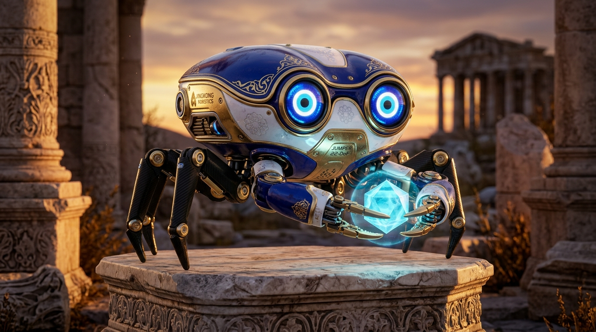
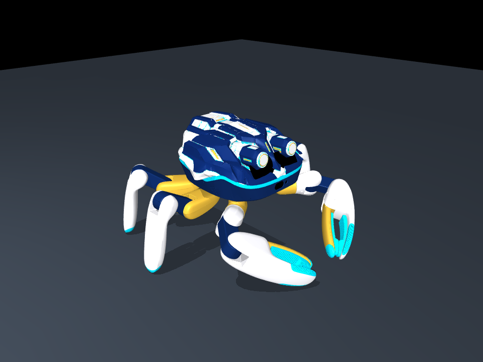
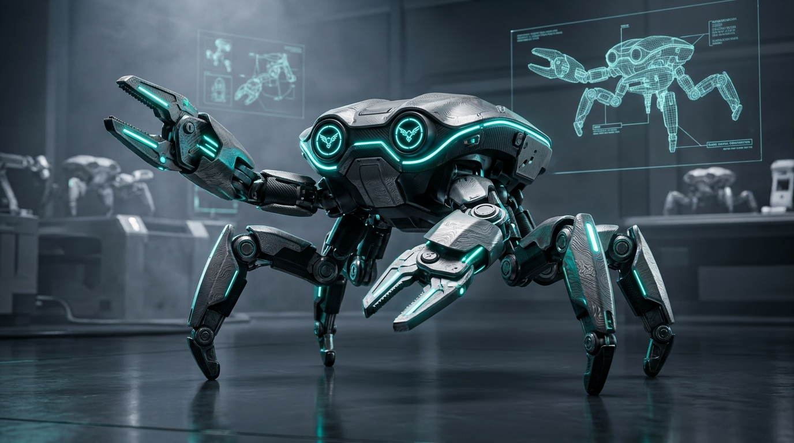
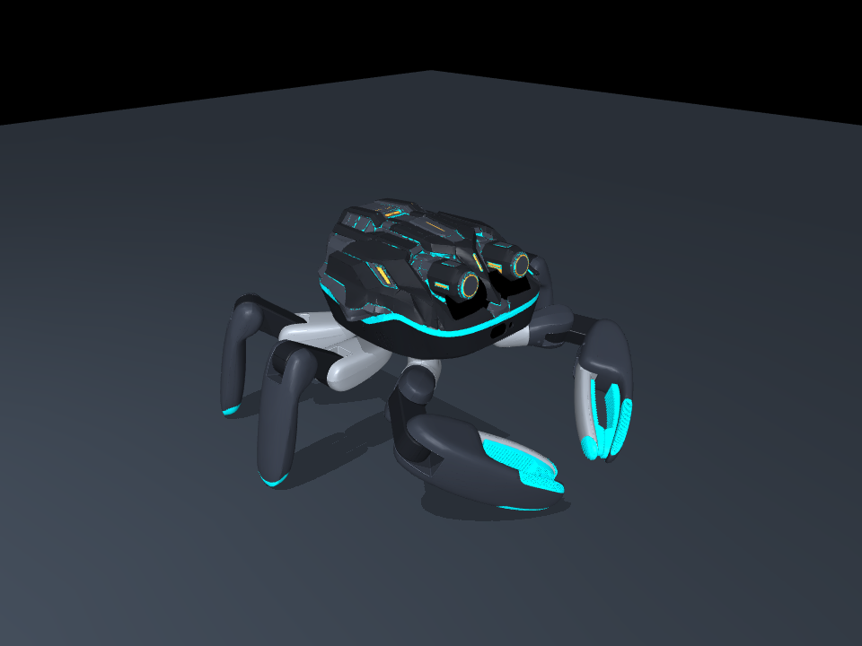

# 🦀 Jumper WERR Reflex & Dual Biomech Skins

[](https://opensource.org/licenses/Apache-2.0)
[](https://mujoco.org)
[](https://github.com/KingKongRobotics/jumper)
[](https://beunlimited.me/en/events/crab-robot-challenge-2026)

Official submission repository for the **Crab Robot Challenge 2026**, hosted by **KingKong Robotics** on the [BeUnlimited](https://beunlimited.me/en/events/crab-robot-challenge-2026) platform.

This project introduces two fully verified, production-ready community skins (`kk-skin-package/3` standard) and a 22-DoF kinematic reflex simulation harness for **Jumper**, the 22-DoF biomimetic crab robot.

---

## 🌟 Contenders Overview

| Concept | Theme & Philosophy | Package | Verification Status |
| :--- | :--- | :--- | :--- |
| **WERR Nazar Sentinel** | Anatolian evil-eye ceramic porcelain talisman & concentric defense telemetry | [`werr-nazar-sentinel.skin`](skins/werr-nazar-sentinel.skin) | ✅ `Passed (MuJoCo 3.17.0)` |
| **WERR Akıncı Cyber-Mech** | Aerospace Damascus titanium & forged carbon tactical debris clearance | [`werr-akinci-cyber.skin`](skins/werr-akinci-cyber.skin) | ✅ `Passed (MuJoCo 3.17.0)` |

### 🧿 1. WERR Nazar Sentinel Crab
Combining cultural cyber-heritage with bio-mechanical multi-legged agility. Designed with Ottoman cobalt blue enamel, porcelain white ceramic limbs, and radiant imperial gold accents.

| Concept Vision | 3D MuJoCo Physics Model |
| :---: | :---: |
|  |  |

* **Live Thread:** [https://x.com/pCwOrM/status/2113646229431169146](https://x.com/pCwOrM/status/2113646229431169146)

---

### ⚡ 2. WERR Akıncı Cyber-Mech
Engineered for rapid urban debris traversal and reconnaissance. Features lightweight forged carbon panels, Damascus titanium joint sleeves, and laser-cyan sensor nodes.

| Concept Vision | 3D MuJoCo Physics Model |
| :---: | :---: |
|  |  |

* **Live Thread:** [https://x.com/pCwOrM/status/2113646523841913266](https://x.com/pCwOrM/status/2113646523841913266)

---

## 🔬 Kinematic Reflex Architecture

The 22 degrees of freedom on Jumper are decoupled across four coordinated quadrants ($Q_1..Q_4$) using a harmonic reflex model augmented with a supercritical pitchfork bifurcation:

$$\frac{d\phi}{dt} = \mu \phi - \beta \phi^3 + \Omega(t)$$

* **Spontaneous Symmetry Breaking ($\mu = 0.20$):** Spontaneously resolves lateral crab-walk deadlocks when encountering physical obstacles without requiring deep neural re-planning.
* **Harmonic Resonance Matrix:** Coordinates alternating tetrapod/tripod gait cycles with active claw counterbalancing torques.
* **Cadence Ballistic Jump:** High-thrust spring compression with dynamic airborne flare and soft 4-point landing stabilization.

---

## 🛠️ Verification & Simulation Quickstart

Both skins conform strictly to KingKong Robotics' `kk-skin-package/3` protocol and pass native MuJoCo forward verification.

### 1. Verify with Shellflow CLI
```bash
python scripts/shellflow.py verify-package \
    --profile robots/jumper/profile.json \
    --mujoco \
    skins/werr-nazar-sentinel.skin
```

Expected output:
```json
{"ok": true, "schema": "kk-skin-package/3", "platform_id": "jumper", "whole_robot": {"links": 41, "joints": 22}, "native_mujoco": {"passed": true}}
```

### 2. Standalone Quick Simulation
```python
import mujoco

# Load assembled skin scene
model = mujoco.MjModel.from_xml_path("unpacked_skins/werr-nazar-sentinel/assembled/jumper/scene.xml")
data = mujoco.MjData(model)
mujoco.mj_step(model, data)
print("Robot base height:", data.qpos[2])
```

---

## 📜 Acknowledgements & License

- Special thanks to the **KingKong Robotics** team for open-sourcing the remarkable 22-DoF Jumper crab robot platform.
- Appearance packages and simulation harness are distributed under the [Apache-2.0 License](LICENSE).
- Developed with pride from Türkiye 🇹🇷.
